## Learning Journey - Job Queue Project

# day 1 - first success

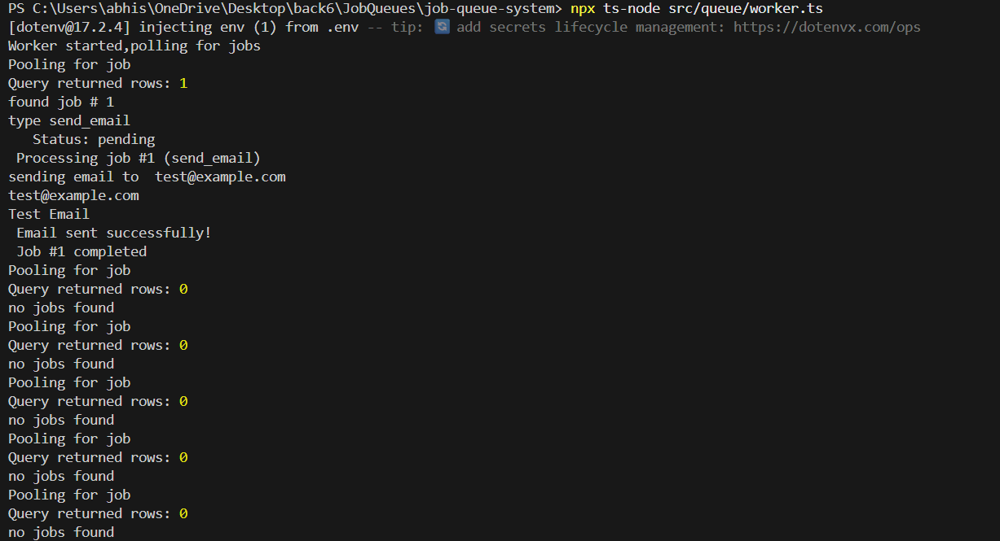

- got worker polling working
- job complete successfully
- worker running in infinite loop to get pending jobs
- bug fixed: job.newAttempts to job.attempts

- Worker pool every 2 seconds
- console shows -> Query returned rows: 0
  no jobs found
- worker is waiting for jobs

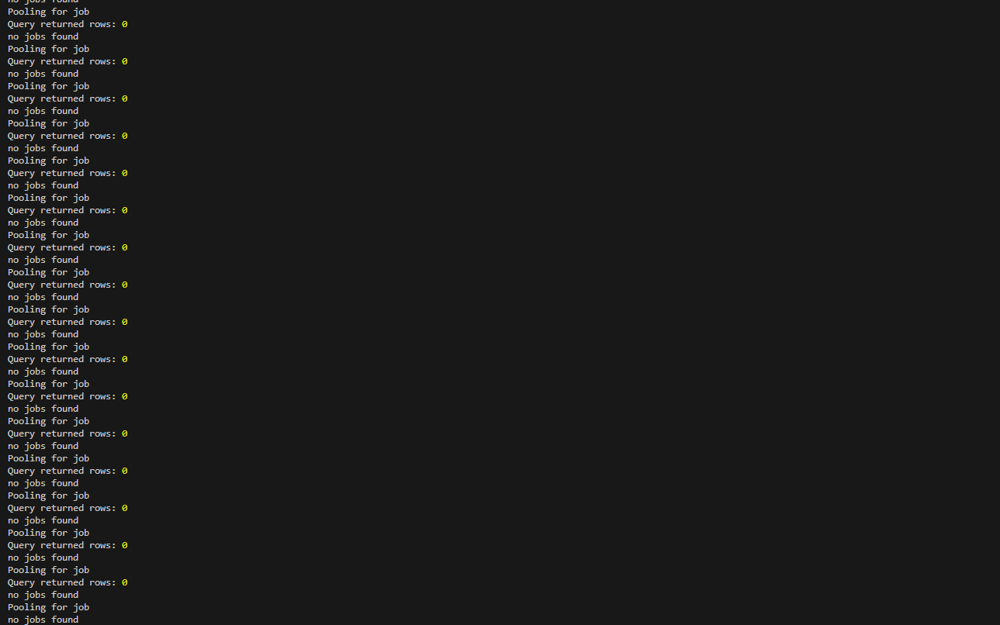

## 2nd enqueue ->

- no job 2nd id because it get failed due to some sql error so i researched about it there it was written that this behaviour is normal in postgres
  it was inserted but due to error during notify it get Rollback -> job 2 get deleted then
- sequence number don't rollback even when transaction fails

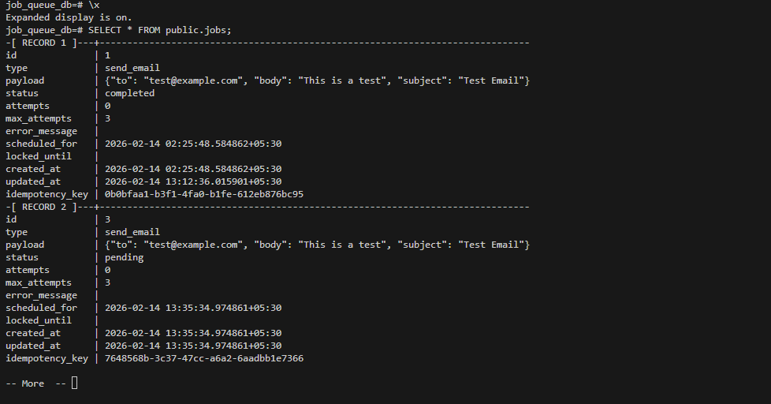

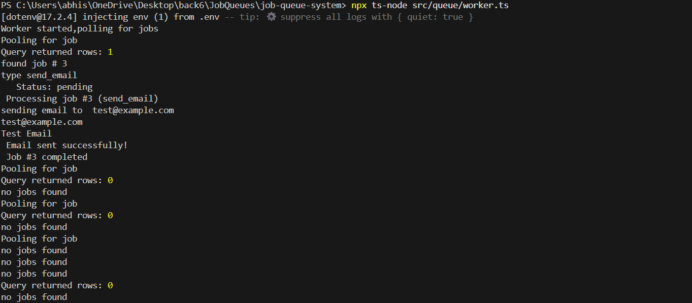

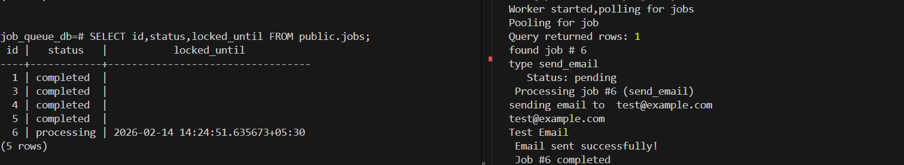

- got many bug while running `failing test`

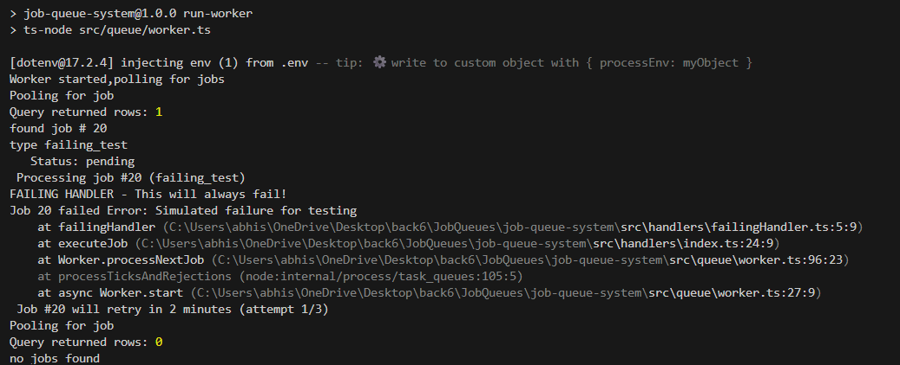
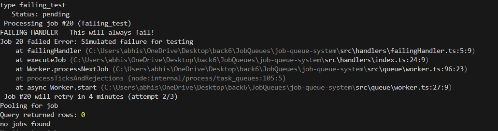
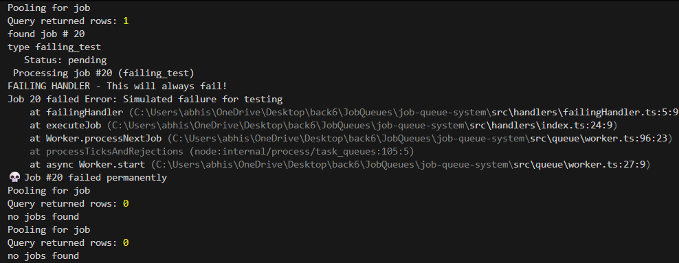

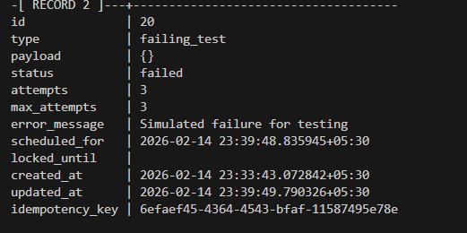

# day 2 (testing 50 jobs for concurrency)

- enqueued 50 jobs and executed 5 worker concurrently to test parallel processing
- implemented job claiming using `SELECT ... FOR UPDATE SKIP LOCKED`
  to enforce row level exclusive locks.
- this gurantees that each worker acquires a single pending job within a transaction.
- competing workers skip already locked-rows ,eliminating race conditions during job selection
  observation : under concurrent load- no duplicate processing occured.

` Concurrency means multiple workers processing jobs during overlapping time. This improves throughput and is not a problem.
The issue arises when concurrent workers access the same shared data without coordination, which can lead to race conditions.
To prevent duplicate job execution, we use PostgreSQL row-level locking with FOR UPDATE SKIP LOCKED.
This ensures that once a worker selects a pending job inside a transaction, it acquires an exclusive lock and other workers skip that row.
As a result, each job is claimed by only one worker under concurrent load.`

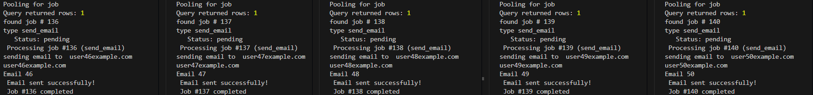
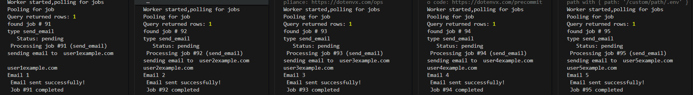

## final test 
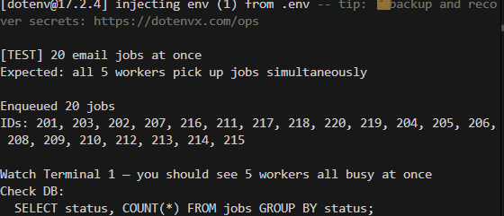
